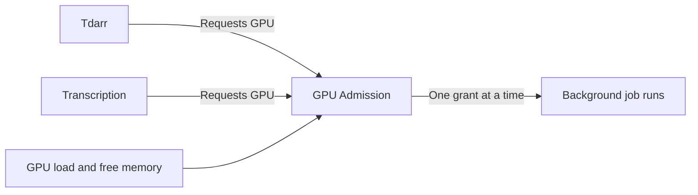

# GPU Admission


**Keep background GPU jobs from getting in the way of what you’re doing.**

## Why it exists

This started on a gaming PC that also ran Tdarr transcodes and voicemail transcription. Both jobs could try to use the GPU while someone was gaming.

- **Keep the PC responsive.** New background jobs wait when the GPU is busy or readings are unavailable.
- **Give each job a turn.** One participating worker receives a grant at a time.
- **Let jobs finish.** Pause or quit without interrupting an admitted workload.



## Install

**You need**

- Windows 11 x64, or an x64 Windows 10 edition supported by .NET 10 with DXCore. [Supported .NET 10 operating systems](https://github.com/dotnet/core/blob/main/release-notes/10.0/supported-os.md)
- A supported NVIDIA GPU for admission, with `nvidia-smi` and working Windows GPU Engine performance counters.
- Docker Desktop and access to the local Linux engine if you plan to connect a Docker worker. A native Windows worker runs without Docker.

**Download the installer**

1. Open [Releases](https://github.com/eslutz/gpu-admission/releases), then download **GPU-Admission-Setup-x64.exe**.
2. Run the installer and select **Open GPU Admission setup** on the final screen. It installs for your account, includes the .NET runtime, and adds a Start menu shortcut.
3. Follow the setup steps below with a build that includes the wizard. Older prereleases have the instructions that match their features in their tagged README.

**Build it yourself**

1. Install the [.NET 10 SDK](https://dotnet.microsoft.com/download/dotnet/10.0) and select the **.NET Desktop Runtime** if it is missing.
2. Clone this repository and run the following in the repo folder. Keep the entire `out` folder together and open **GpuAdmissionTray.exe**.

```powershell
dotnet publish src/GpuAdmissionTray.csproj -c Release -r win-x64 --self-contained false -o out
```

## Set up the app

1. Pick the GPU you want to share, then select **Verify readings**. If a counter is missing, wake the adapter with a small workload and retry.
2. Select **Save in Hold**. The app creates the settings and stays paused while you connect workers.
3. Optional. Open **Diagnostics** and check **Start GPU Admission when I sign in**. If the app is already started by a scheduled task, keep using that task or switch to the checkbox.

The state lives under `%LOCALAPPDATA%\GpuAdmission` by default. When upgrading, use **Quit** and let the current job finish before opening the new version. Keep the same state folder. For an existing custom install, keep its `root.txt` beside the executable. It contains the absolute path to that folder.

Use **Repair GPU setup** in the tray menu if an existing profile loses its readings after a restart or driver update. The app verifies the same GPU and waits for Hold and ownership to clear before saving the updated adapter binding.

## Connect a worker

Open **Workers → Add worker**. Choose an ID such as `video-worker` and save it in **Hold**. Every worker needs its own ID and request folder.

### Windows executable

1. Select an executable that performs a finite job in its own process tree. Enter one argument per line.
2. Select the worker, then **Test Windows**. This checks the connection while admission is held. It reads status and writes a presence record.
3. Use **Connection details** to copy the launcher command into your script or scheduled task. Use that command each time you would otherwise launch the job.
4. Select **Enable worker**, then use **Resume** on **Overview**. Try a small job before scheduling regular work.

The launcher waits for a grant, starts the executable inside a Windows Job Object, and releases after the whole process tree exits. Run it under the same Windows account as the tray. The launcher is for native executables. Jobs delegated to an existing process, a Windows service, or WSL2 need a different integration.

### Docker container

1. Select the local container that will actually launch the GPU process.
2. Under **Connection details**, copy the two Compose bind mounts. Add them to the service and apply the change. The shared status mount stays read-only, and this worker can write to its own request folder.
3. Include the [Linux reference client](integrations/gpu_admission_client.py) in the container. In your worker, use its lease around every GPU job. Follow the [worker integration guide](integrations/README.md) for the lifecycle and an example. Keep a single in-flight job per worker.
4. Run the connection command shown under **Connection details** from inside the container. The worker will briefly show **Connected / idle**.
5. Select **Enable worker**, then use **Resume**. Confirm a small job moves from waiting to granted to running and releases after exit.

Existing v1 workers can keep their current worker IDs, mounts, and integration. The protocol still uses a 15-second freshness window.

## What you’ll see

**Overview** shows why work is paused, the GPU readings, and each worker’s mode. Use **Appearance** to choose Light, Dark, or System. System follows the Windows app theme. **Diagnostics** has process usage, the last GPU sample, and startup settings.

| Worker state | Meaning |
| --- | --- |
| Registered | The worker is configured. Recent presence hasn’t been confirmed. |
| Connected / idle | A recent heartbeat confirms communication. |
| Waiting | The worker has an outstanding request. |
| Granted | The guard reserved or granted the GPU. |
| Running | The worker confirmed that it started the granted job. |
| Recovery required | Ownership is retained until the guard can confirm the job ended. |

**Pause** holds new work. **Resume** follows the GPU checks and each worker’s policy. **Quit** drains current ownership before closing. Use **Open current log** or **Open log folder** from the tray menu for event history. Logs rotate daily or at 1 MiB, with 30 days of retention and a 20 MiB total cap.

## GPU support

| GPU | What this build can do |
| --- | --- |
| NVIDIA | Admission when the driver UUID, free memory, and Windows engine readings match the selected adapter. |
| Dedicated AMD Radeon or Intel Arc | Monitor Windows readings. Optional ADLX and IGCL probes can help qualify device-wide dedicated memory. |
| Integrated GPUs | Monitor available Windows readings. |

AMD and Intel admission requires real hardware qualification. See [GPU qualification](native/README.md). Docker GPU compatibility must also be checked inside the container.

## Releases

1. Set `<Version>` in [the app project](src/GpuAdmissionTray.csproj), for example `0.2.0-preview.1`. The .NET build stamps the app with this version, and the installer uses the same value.
2. Merge the version change into `main` and wait for **Windows installer** CI to pass. CI saves the installer, matching source ZIP, checksums, and build details.
3. In **Actions → Publish prerelease → Run workflow**, select `main`. Run with **publish** unchecked to verify the release inputs. Check **publish** only when you approve publication. The workflow creates the matching `v` tag and publishes the installer and corresponding source together as a prerelease.

A version can be published once. Increase the version in the app project for the next prerelease. The current build is unsigned. Smart App Control may block it.

## License

GPU Admission is licensed under [GNU GPL version 3](LICENSE) (GPL-3.0-only).

When publishing an installer, offer the complete Corresponding Source for the exact build alongside it at no additional charge. Include the project source, build and installer scripts, and any bundled covered code needed to build the distributed version. Build from the published source, preserve copyright and license notices, and check the licenses and source obligations for bundled third-party components before publishing. CI packages the project source alongside the installer. Keep matching source available wherever the installer is offered. [GPLv3, sections 4–6](https://spdx.org/licenses/GPL-3.0-only.html)
