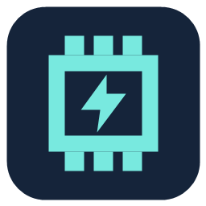

# GPU Admission



A Windows notification-area utility that coordinates GPU access between cooperating
local workers. The dashboard shows GPU telemetry, workload policy, process CPU and
memory, and diagnostics. Pause holds new admissions. Quit waits for the current
owner to release before the guard exits.

## Build

Use Windows and the .NET 10 SDK. The executable requires the .NET 10 Windows Desktop
Runtime. The guard uses Windows PowerShell, NVIDIA's `nvidia-smi`, Windows GPU Engine
performance counters, and Docker CLI to confirm when a configured container has stopped.

```powershell
dotnet publish src/GpuAdmissionTray.csproj -c Release --self-contained false -o out
powershell -NoProfile -File src/Test-GuardLifecycle.ps1
```

## Configure

Use an installation directory and a private state directory writable only by the
account running the guard and the administrators responsible for the machine.
The default state directory is `%ProgramData%\GpuAdmission`. To use a different
private directory, put its absolute path in `root.txt` next to the executable.

Create `bin`, `logs`, `public\grants`, and `requests\<consumer-id>` under the
state directory. Copy `config.example.json` to `bin\config.json` and set the state
directory, NVIDIA GPU UUID, Windows adapter LUID and index, and Docker container
names. Create `modes.json` with the following initial settings.

```json
{"policy_mode":"Hold","consumer_modes":{"example-worker":"Hold"}}
```

Run `out\GpuAdmissionTray.exe` as the signed-in account with the configured Docker
access. Use one interactive, limited-user Task Scheduler task for startup at sign-in
if desired. Keep Hold until you verify telemetry and connect a compatible worker.

The versioned `home-network-gpu-admission/v1` file format is retained for existing
integrations. Consumers read only the status and grant files and submit requests
through their own request directories. They must cooperate with the grant and
heartbeat rules, including the 15-second freshness window. Installing the tray
alone does not pause or start an arbitrary application.

Current and rotated JSONL logs are kept under `logs`, with a 30-day retention and
20 MiB cap. The previous event log rotates daily or when it reaches 1 MiB.
Run the executable with `--status` to open the dashboard from a shortcut or command line.
