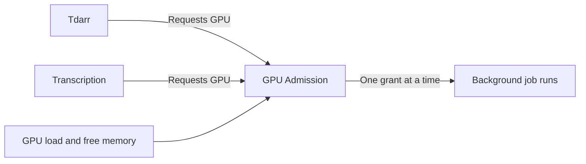

# GPU Admission


**Let background jobs share your GPU without getting in the way of what you're doing.**

## Why it exists

This started on a gaming PC that also ran Tdarr video transcodes and voicemail transcription. Both jobs could try to use the same GPU, even while someone was gaming.

- **Keep the PC responsive.** New background work waits when the GPU is busy or telemetry is unavailable.
- **Avoid overlap.** One participating worker gets permission at a time.
- **Finish in-flight work.** You can hold new jobs without interrupting the current one.



## What you can do from the tray

- **Status** shows GPU readings, workload modes, and CPU and memory usage.
- **Pause / Resume** controls whether new jobs can start. Resume still follows GPU availability and each worker's settings.
- **Quit** waits for the current worker to release the GPU, then closes the app.
- **Open logs** opens the event history. Logs rotate daily or at 1 MiB and are kept for up to 30 days, with a 20 MiB total cap.

## Requirements to run

- **64-bit Windows** with **Windows PowerShell**. The installer includes the .NET runtime.
- **An NVIDIA GPU** with a driver that provides `nvidia-smi`. The app uses it to identify the GPU and read free video memory. AMD and Intel GPUs are currently unsupported.
- **Windows GPU Engine performance counters** for the configured NVIDIA adapter. If either telemetry source is unavailable, admission stays on hold.
- **Docker CLI and access to a running Docker engine** for checking the configured worker containers.
- **A compatible worker** that requests a GPU grant before starting work. See [Worker compatibility](#worker-compatibility).

## Install on Windows

Choose either path. Both use the same setup steps below.

| Install from a release | Build it yourself |
| --- | --- |
| Open [Releases](https://github.com/eslutz/gpu-admission/releases). Download and run **GPU-Admission-Setup-x64.exe** from a tagged release. It installs for your Windows account, adds a Start menu shortcut, and includes the .NET runtime. | Install the **.NET 10 SDK** and the **.NET 10 Windows Desktop Runtime**. Clone the repo and run the command below from the repo folder. Keep the entire `out` folder together in a permanent location. |

```powershell
dotnet publish src/GpuAdmissionTray.csproj -c Release --self-contained false -o out
```

Before upgrading, use **Quit** and let running work finish. Keep your existing state directory.

## First run

1. **Open PowerShell under your normal Windows account.** Check that `nvidia-smi -L` lists your GPU and `docker ps` can reach Docker.
2. **Choose a worker ID and container name.** This example uses `example-worker` for both. The ID must start with a lowercase letter and use only lowercase letters, digits, and hyphens (up to 48 characters). The container name must match the container that actually runs the GPU job.
3. **Create the state folders.** Run the commands below from the repository root or the installed app folder, where `config.example.json` lives. Run this only for a fresh setup.

```powershell
$root = Join-Path $env:LOCALAPPDATA 'GpuAdmission'
if (Test-Path "$root\bin\config.json") { throw 'Configuration already exists' }
'bin', 'logs', 'public\grants', 'requests\example-worker' | ForEach-Object {
    New-Item -ItemType Directory -Path (Join-Path $root $_) -Force | Out-Null
}
$config = Get-Content .\config.example.json -Raw | ConvertFrom-Json
$config.root = $root
$config | ConvertTo-Json -Depth 6 | Set-Content "$root\bin\config.json" -Encoding UTF8
'{"policy_mode":"Hold","consumer_modes":{"example-worker":"Hold"}}' |
    Set-Content "$root\modes.json" -Encoding UTF8
```

4. **Identify the GPU.** Copy the NVIDIA UUID from `nvidia-smi -L` into `gpu` in `bin\config.json`. While the target GPU is doing work, run the following in PowerShell to list Windows GPU Engine instance names. From a matching instance such as `pid_1234_luid_0x00000000_0x0001171a_phys_0_eng_0_engtype_3D`, use `0x00000000_0x0001171a` for `windows_engine_luid` and `0` for `windows_physical_index`. On a multi-GPU PC, match the Windows instance to a process using the intended GPU. Leave admission on Hold if you cannot confirm the pairing.

```powershell
(Get-Counter '\GPU Engine(*)\Utilization Percentage').CounterSamples |
    Select-Object -ExpandProperty InstanceName -Unique
```

5. **Open GPU Admission.** Use the Start menu after installing, or run `.\out\GpuAdmissionTray.exe --status` from the source checkout. Check that the GPU readings appear. The two Hold settings pause all new jobs and this worker respectively. Both must be Auto to admit a new job.
6. **Optional: start at sign-in.** Check **Start GPU Admission when I sign in** in the dashboard. It starts in the tray for your Windows account. If you already use a scheduled task for this app, choose one startup method.

For a custom state directory, place its absolute path in `root.txt` next to the executable. Upgrading an existing install that uses `%ProgramData%\GpuAdmission`? Keep pointing `root.txt` to that directory so the ownership journal and worker mounts stay together.

## Connect your own worker

GPU Admission is a coordinator. Your worker needs to ask permission before starting its GPU process.

1. **Mount two folders.** Give the worker read-only access to `public` and write access to its own `requests\example-worker` folder. For Docker, bind these to paths such as `/admission/read` and `/admission/request`. Give each worker its own request directory.
2. **Request the GPU.** Read `/admission/read/status.json`. When status is fresh and both policies are Auto, write the request below to `/admission/request/<request_id>.json`. To update a request, write to a temporary file in the same directory and rename it over the original. Refresh both timestamps every five seconds while waiting or running.
3. **Wait for the two-step grant.** Read `/admission/read/grants/example-worker.json`. After a matching `reserved` grant, change the request's `state` to `active`. Start the GPU process only once you receive a matching `active` grant and the latest status confirms the same request and both policies are still Auto.
4. **Release when the GPU process exits.** Write `state: "released"` with fresh timestamps after confirming the GPU process has exited. If status or grants disappear, stop accepting new GPU work. An already admitted process can finish and release normally. If canceled before launch, release the reservation once you know no GPU process started.
5. **Test before enabling real work.** Give the worker its own ID in `modes.json`, set its mode to Auto, then use **Resume** for the global switch. Test with a small job. Check that it waits while paused, starts only after the active grant, and releases after exit.

Example request. Use a new random ID of 32 lowercase hexadecimal characters, copy `generation` and `gpu` from the current status, and use numeric Unix timestamps in seconds.

```json
{
  "schema": "home-network-gpu-admission/v1",
  "consumer": "example-worker",
  "request_id": "0123456789abcdef0123456789abcdef",
  "generation": "<from status.json>",
  "gpu": "<from status.json>",
  "state": "requested",
  "observed_at": 0,
  "heartbeat_at": 0,
  "minimum_free_vram_mib": 4096
}
```

For every grant check, verify the schema, consumer, request ID, GPU UUID, and generation. Both status and grant must be between 0 and 15 seconds old. The status for the active grant must identify the same consumer and request ID. Keep one in-flight request per worker and start the GPU job only once for that request.

## Release policy

- GitHub Actions builds a Windows installer and checksum as build artifacts. Pushing a tag does not publish them to Releases.
- Publish only after the repository owner explicitly approves that release. Mark all approved releases as **prerelease** until the owner changes this policy.
