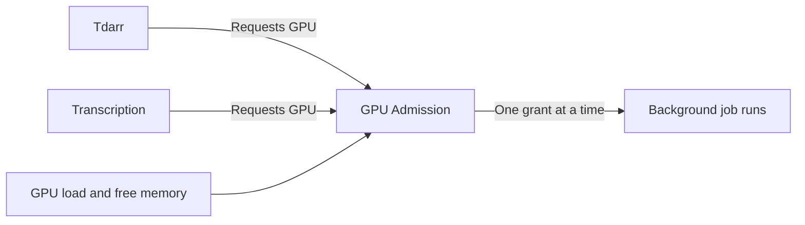

# GPU Admission


**Let background jobs share your GPU without getting in the way of what you're doing.**

## Why it exists

This started on a gaming PC that also ran Tdarr video transcodes and voicemail transcription. Both jobs could try to use the same GPU, even while someone was gaming.

- **Keep the PC responsive.** New background work waits when the GPU is busy or telemetry is unavailable.
- **Avoid overlap.** One participating worker gets permission at a time.
- **Finish in-flight work.** You can hold new jobs without interrupting the current one.



## What you can do from the tray

- **Status** shows GPU readings, workload modes, and CPU and memory usage.
- **Pause / Resume** controls whether new jobs can start. Resume still follows GPU availability and each worker's settings.
- **Quit** waits for the current worker to release the GPU, then closes the app.
- **Open logs** opens the event history. Logs rotate daily or at 1 MiB and are kept for up to 30 days, with a 20 MiB total cap.

## Build on Windows

- **Build:** .NET 10 SDK.
- **Run:** .NET 10 Windows Desktop Runtime, Windows PowerShell, NVIDIA's `nvidia-smi`, and Windows GPU Engine counters.
- **Docker:** The guard uses the Docker CLI to confirm when a configured worker container has stopped.

```powershell
dotnet publish src/GpuAdmissionTray.csproj -c Release --self-contained false -o out
powershell -NoProfile -File src/Test-GuardLifecycle.ps1
```

## Set up a worker

1. **Choose a private state folder.** The default is `%ProgramData%\GpuAdmission`. To change it, put the absolute path in `root.txt` next to the executable. Limit write access to the guard account and the administrators who manage the PC.
2. **Create the folders.** Add `bin`, `logs`, `public\grants`, and `requests\<consumer-id>` for each worker.
3. **Configure the GPU and containers.** Copy [the sample configuration](config.example.json) to `bin\config.json`. Set the state folder, NVIDIA GPU UUID, Windows adapter LUID and index, and Docker container names.
4. **Start in Hold.** Create `modes.json` using the example below. Replace `example-worker` with your configured worker ID.
5. **Open the dashboard.** Run `out\GpuAdmissionTray.exe --status` as the signed-in account with Docker access. Verify GPU readings and connect a compatible worker before enabling admission. For automatic startup, use one interactive, limited-user Task Scheduler task.

```json
{"policy_mode":"Hold","consumer_modes":{"example-worker":"Hold"}}
```

## Worker compatibility

- A compatible worker requests permission before starting GPU work. Installing the tray alone won't control other apps.
- Workers read the shared status and their own grants, and write requests in their assigned directories.
- The existing `home-network-gpu-admission/v1` protocol uses a 15-second freshness window for status and grants.
